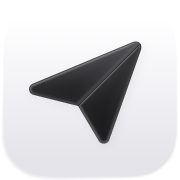

  <picture>
    <source media="(prefers-color-scheme: dark)" srcset="apps/mobile/assets/icons/previews/rodge-mail-dark.png">
    
  </picture>

 

This project is my personal email server and client. It's set up to connect with gmail, outlook, and iCloud, while also allowing you to create inboxes for your custom domains via [SES](https://aws.amazon.com/ses/).

This is intentionally **_NOT_** a product that you can sign up and pay for. If you want to use this, fork it and shape it to your liking. In an afternoon, you can have your own personal email setup on all your devices.

